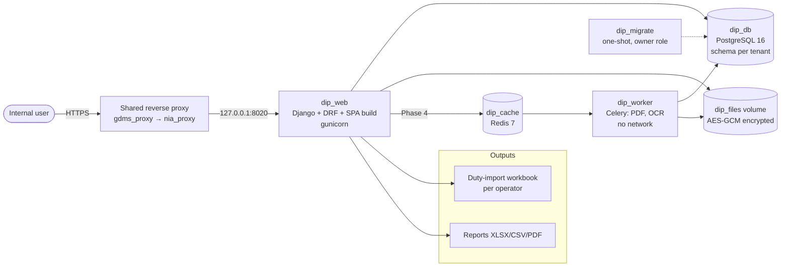
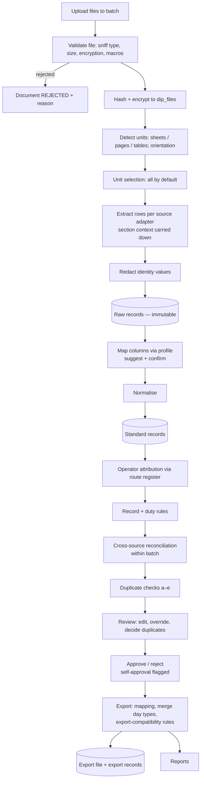
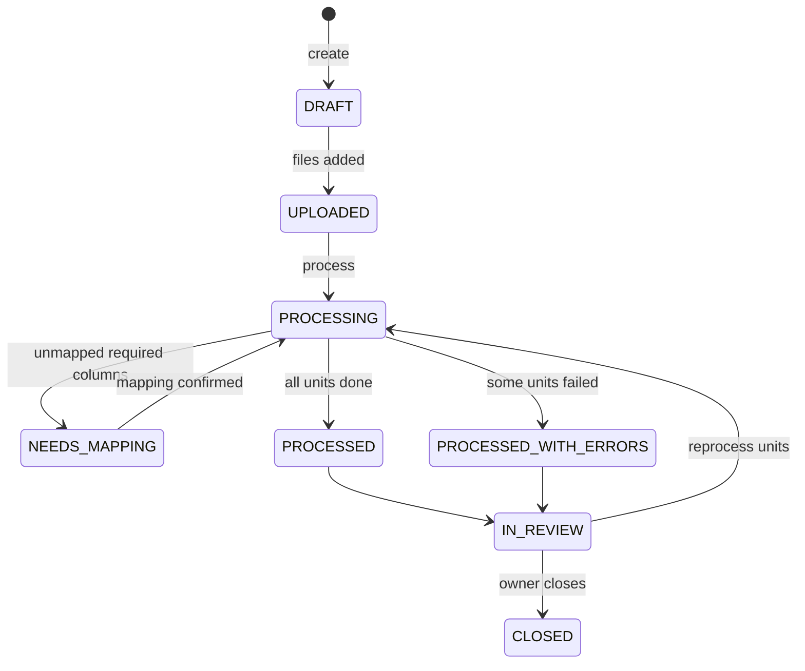
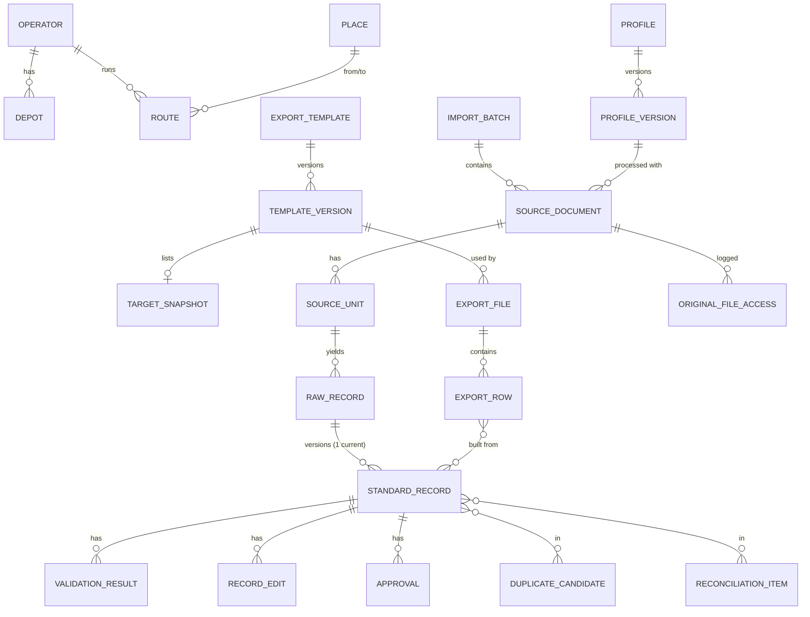

**Nia Document Import Platform (DIP)**

**DIP-PDS-001 — Architecture, Data Model and API Specification**

| Field | Value |
|---|---|
| Version | 0.1 — draft for owner review |
| Date | 10 November 2026 |
| Covers | Phase 1 steps 1.4 (architecture), 1.5 (data model and ERD), 1.6 (API design) |
| Governing documents | DIP-URD-001 v0.4 (requirements win where they differ; conflicts are flagged, not resolved silently); ADR-DIP-001 to 006; DIP-FIX-001 v0.3 |
| Merge target | TDH: TDH-URD-OBR-001 Amendment A1 rev. 1; ADR-TDH-015 |

## 1. Architecture at a glance

DIP is one Django + DRF application, with a React SPA and a framework-free processing core (`dip_core`). It runs as a small Docker Compose stack. Only the shared reverse proxy is public; every DIP port binds to 127.0.0.1.



| Container | Image | Role | Ports | Phase |
|---|---|---|---|---|
| `dip_web` | `dip` | Django + DRF API, serves the built SPA (WhiteNoise), runs synchronous spreadsheet and CSV parsing | 127.0.0.1:8020 → 8000 | 2 |
| `dip_db` | postgres:16 | Database; one schema per tenant (django-tenants) | none published | 2 |
| `dip_migrate` | `dip` | One-shot: `migrate_schemas`, then `apply_db_grants`, as `dip_owner`; exits | — | 2 |
| `dip_bootstrap` | `dip` | One-shot (profile `bootstrap`): creates the `dip_owner` and `dip_app` roles | — | 2 |
| `dip_cache` | redis:7 | Celery broker and results | none published | 4 |
| `dip_worker` | `dip-worker` (adds Tesseract) | PDF table extraction and OCR; network `internal: true` | — | 4 |

These follow the TDH M2 patterns: separate owner and runtime database roles; the web container holds only the runtime credentials; json-file log rotation (10 MB × 10); explicit environment variable lists per service; and `.env` is never printed (ADR-TDH-008, CLAUDE.md rule).

## 2. Code structure

```
nia-dip/
├── backend/
│   ├── config/            settings (env-driven), urls, celery, dbroles
│   ├── dip_core/          NO Django imports — moves to TDH unchanged
│   │   ├── sources/       xlsx.py, xls.py, csv.py, pdf_text.py, pdf_ocr.py   (one adapter per format)
│   │   ├── layout/        orientation, grid detection, header anchoring, sections, summary rows
│   │   ├── redact/        identity column rules, SA ID detector (date + Luhn)
│   │   ├── mapping/       suggestion (difflib, fingerprint), apply
│   │   ├── normalise/     times (04H15, 04:15, Excel, >24:00), day types, code lists, case
│   │   ├── rules/         rule registry, record, duty, batch, cross-source and export-compatibility rules
│   │   ├── reconcile/     cross-document matching (operator, day type, duty, start)
│   │   ├── dedup/         file hash, row fingerprint, business key
│   │   ├── export/        template writer (openpyxl), day-type merge, reproducible zip
│   │   ├── crypto/        file envelope encryption (AES-GCM, per-file keys)
│   │   └── schemas/       JSON Schemas for profiles and templates (Draft 2020-12)
│   ├── apps/              Django apps (names chosen to drop into TDH)
│   │   ├── tenants/  accounts/  audit/  reference/  profiles/
│   │   ├── imports/       batches, documents, units, raw and standard records, review
│   │   ├── exports/       templates, snapshots, export files and records
│   │   ├── reports/  retention/  api/
│   └── tests/{unit,integration,e2e_fixtures}/
├── frontend/src/features/{dashboard,upload,review,mapping,approval,export,reports,reference,admin}/
├── deploy/  docs/  fixtures/README.md   (real fixtures live outside Git)
```

**Rules:**
- `dip_core` functions take and return plain data (dataclasses or dicts), never ORM objects.
- Django apps call `dip_core` and persist the results.
- Provider specifics live only in profile JSON, never in code branches.

## 3. Processing pipeline



**Batch state machine** (processing state only; review and export state live per record):



**Record statuses** (three independent fields, FR-DIP-052):
- `processing_status`: SUCCESS, SUCCESS_WITH_DISCREPANCIES, FAILED.
- `review_status`: PENDING, APPROVED, REJECTED.
- `export_status`: NOT_EXPORTED, EXPORTED. A record may be in several export files; each is an export record.

**Reprocessing** creates new standard records (version + 1) linked to the same raw record. Earlier versions are kept, marked superseded, and never deleted.

**Source adapters for the Makhado fixtures:**

| Profile type | Adapter | Key settings |
|---|---|---|
| Monitoring timetable (P-MON) | `pdf_ocr` | Page header fields (Monitoring Point, Time, Period Week) as section context; column anchors by header text; per-column character sets (`VHE1_ddd`, `ddHdd`); route register and place list for suggestions; signature block ignored |
| Operator duty sheet (P-DSH) | `pdf_ocr` (typed) | Operator from page header; Morning/Afternoon blocks; "Sub total kilometers" as summary rows; day type set at upload (default Monday–Friday) |
| Operator workbook (P-WBK) | `xlsx` | Header row detection; header aliases (Schedule Time / Monitoring Time); cached formula values for End Time; extra empty columns ignored |

## 4. Data model

All tables below live in the **tenant schema**. The public schema holds only tenants, domains and platform staff (ADR-DIP-003).



### 4.1 Reference data (app `reference`)

All reference tables are versioned with copy-on-write (`lineage_id`, `version`, `valid_from`, `status`), so a batch can show the reference data it used.

| Table | Key columns | Constraints and notes |
|---|---|---|
| `reference_operator` | `code` (stable, e.g. DOLIGHT), `name`, `status` | `code` unique; maps to the TDH Operator at the merge |
| `reference_depot` | `operator_id`, `target_name`, `is_default` | Partial unique index: one `is_default` per operator |
| `reference_place` | `name`, `aliases` (text[]) | Name unique, compared case-insensitively (`citext`) |
| `reference_route` | `code` (VHE1_001), `operator_id`, `from_place_id`, `to_place_id`, `description`, `service_type`, `status`, `target_name` (nullable; default pattern "{From} to {To}") | Unique (`code`, `from_place_id`, `to_place_id`): one row per direction |
| `reference_monitoring_point` | `name`, `aliases` | — |

### 4.2 Configuration (apps `profiles`, `exports`)

| Table | Key columns | Notes |
|---|---|---|
| `profiles_profile` / `_version` | `operator_id` (nullable for multi-operator), `source_type` (MON, DSH, WBK, CSV), `version`, `settings` (jsonb, schema-validated), `status`, `approved_by`/`_at` | Approved versions are immutable (trigger) |
| `exports_template` / `_version` | `name`, `kind` (WORKBOOK, CSV), `file_key`, `file_sha256`, `column_map` (jsonb), `defaults` (jsonb: Status Active, Approval Approve, merge on, split per operator), `unsupported_parts` (jsonb), `accepted_by`/`_at`, `status` | Template file kept encrypted, never purged with originals |
| `exports_target_snapshot` | `template_version_id`, `taken_at`, `depots` (jsonb), `routes` (jsonb) | Read from the *Lists* sheet; informational (FR-DIP-084) |

### 4.3 Import lineage (app `imports`)

| Table | Key columns | Constraints and indexes |
|---|---|---|
| `imports_batch` | `id` (UUID), `name`, `created_by`, `status`, `default_depot_map` (jsonb: operator → depot), `day_type_override` (for duty sheets), `counts` (jsonb, derived) | — |
| `imports_source_document` | `batch_id`, `file_name`, `sha256`, `size`, `detected_type`, `file_key`, `profile_version_id`, `status`, `reject_reason`, `retention_until`, `hold`, `hold_reason`, `purged_at` | Index on `sha256` (duplicate level a). `file_key` is random; the user's file name is never used as a path |
| `imports_source_unit` | `document_id`, `kind` (SHEET, PAGE, TABLE, SECTION), `name`, `page_no`, `hidden`, `rotation`, `selected`, `skip_reason`, `context` (jsonb: monitoring point, time, period week, operator header) | — |
| `imports_raw_record` | `unit_id`, `row_ref` (sheet row or page + line), `source_no` (printed No./Rec ID), `kind` (DATA, SUMMARY, HEADER), `values` (jsonb: original header → original value, **after redaction**), `redactions` (jsonb: column → marker), `extraction_method`, `confidence` (per-cell jsonb, int per mille), `fingerprint` (sha256 of the normalised raw row) | **Append-only** (trigger). Index on (`unit_id`, `row_ref`) and on `fingerprint` (duplicate level b) |
| `imports_standard_record` | `raw_record_id`, `version`, `is_current`, `operator_id`, `depot_id`, `duty_no`, `route_id`, `route_code`, `from_place_id`, `to_place_id`, `trip_start_min`, `trip_end_min`, `trip_end_source` (RAW, MATCHED_DOC, HISTORY, REVIEWER), `trip_end_source_ref`, `day_type`, `day_mask` (smallint, bit 0 = Sun … bit 6 = Sat), `time_period`, `monitoring_point_id`, `schedule_min`, `rev_km`, `positioning_km`, `contract_ref`, `contract_route` (bool), `original` (jsonb: original value per field), `processing_status`, `review_status`, `export_status`, `self_approved` (bool), `business_key` (text) | Partial unique on (`raw_record_id`) where `is_current`. Index on `business_key` (level c/d); index on (`operator_id`, `duty_no`, `day_mask`). Times are minutes after the start of the service day (0–2879), so past-24:00 trips are allowed |
| `imports_validation_result` | `record_id` (or `batch_id` / `duty_key` for duty- and batch-level rules), `rule_code`, `scope` (RECORD, DUTY, BATCH, CROSS_SOURCE, EXPORT), `severity` (ERROR, WARNING, INFO), `field`, `message`, `overridden_by`/`_at`/`reason` | Overriding an ERROR is blocked by a database CHECK |
| `imports_record_edit` | `record_id`, `field`, `old`, `new`, `reason`, `by`, `at` | Append-only |
| `imports_duplicate_candidate` | `level` (a–e), `record_ids` (or document ids), `decision` (KEEP_BOTH, SKIP, REPLACE), `reason`, `by`, `at` | — |
| `imports_reconciliation_item` | `batch_id`, `operator_id`, `day_type`, `duty_no`, `check` (COUNT, START, FROM, ROUTE, END_BEFORE_START, MISSING_IN_SOURCE), `left_ref`, `right_ref`, `detail` | — |
| `imports_approval` | `record_id`, `decision`, `reason`, `by`, `at`, `self_approved` | Append-only |

**Business key** (FR-DIP-070): operator + day type + duty no. + route + From + trip start, joined in a canonical text form and stored as `business_key`.

### 4.4 Exports and reports

| Table | Key columns | Notes |
|---|---|---|
| `exports_export_file` | `template_version_id`, `operator_id` (null when combined), `options` (jsonb: merge, split, defaults used), `row_count`, `record_count`, `sha256`, `file_key`, `created_by`, `created_at` | Never overwritten; append-only |
| `exports_export_row` | `export_file_id`, `row_no`, `values` (jsonb, as written), `record_ids` (uuid[]; several when day types are merged) | Append-only |
| `reports_report` | `type`, `scope` (batch or date range), `format`, `sha256`, `file_key`, `by`, `at` | — |

### 4.5 Audit and retention

- `audit_log`, `audit_checkpoint`: the TDH M2 design, copied. Hash-chained and written by triggers. `dip_app` has SELECT and INSERT only. The actor and request id are set per transaction.
- `imports_original_file_access`, `retention_purge_run`: insert-only event tables, so downloads and purges reach the audit chain (TDH OBR A1 NFR-OBR-005 pattern).
- `retention_setting`: one row per data class (ORIGINAL, RAW, STANDARD, EXPORT, REPORT, AUDIT), with `days` and `automated` (only ORIGINAL is true in the MVP).

**Immutability:** `raw_record`, `record_edit`, `approval`, `export_file`, `export_row`, approved profile and template versions, and the audit tables reject UPDATE and DELETE by trigger. The runtime role also lacks those grants.

### 4.6 Migration strategy

- Django migrations only. Every migration is reversible and tested backwards in CI.
- Data migrations carry `reverse_code`.
- SQL for triggers and grants lives in `core` migrations, as in TDH.
- `apply_db_grants` runs after every migration, as `dip_owner`.

## 5. Configuration schemas (excerpt)

Profiles are JSON validated against `dip_core/schemas/profile.schema.json`. An excerpt of a P-WBK profile:

```json
{
  "source_type": "WBK",
  "operator": "MABIRIMISA",
  "units": {"select": "all", "skip_hidden": false},
  "header": {"detect": "auto", "max_scan_rows": 30},
  "columns": {
    "duty_no":    {"headers": ["Schedule Shift No", "Duty No"]},
    "route_code": {"headers": ["Route Code", "Route"]},
    "from":       {"headers": ["From"]},
    "to":         {"headers": ["To"]},
    "trip_start": {"headers": ["Depart Time"], "type": "time"},
    "trip_end":   {"headers": ["End Time"], "type": "time", "formula": "cached_value"},
    "schedule":   {"headers": ["Schedule Time", "Monitoring Time"], "type": "time"},
    "day_type":   {"headers": ["Day Type"]},
    "contract_ref": {"headers": ["contract", "contract_code", "contract_no"], "optional": true}
  },
  "identity_columns": ["driver", "driver name", "employee no", "id number"],
  "normalise": {"day_type": {"Morning - Friday": "Monday - Friday"}},
  "contract_ref_fallback": "route_code_prefix",
  "confidence_threshold_permille": 800,
  "rules": {"END_AFTER_START": "ERROR", "TRIP_END_MISSING": "ERROR"}
}
```

The export template column map is configuration too. Each target column names a standard-record field, a constant, or a derivation from a fixed list (`day_flag(Sun)`, `route_target_name`, `contract_route_yn`). No column mapping is hard-coded.

## 6. Rule catalogue (initial)

| Code | Scope | Default severity | Source |
|---|---|---|---|
| REQUIRED_CORE (duty, route, start, end) | Record | ERROR | FR-DIP-040 |
| TIME_INVALID | Record | ERROR | FR-DIP-041 |
| END_AFTER_START | Record | ERROR | FR-DIP-050, target |
| ROUTE_UNREGISTERED / OPERATOR_UNASSIGNED | Record | ERROR | FR-DIP-037 |
| ROUTE_FROM_TO_MISMATCH | Record | WARNING (+ suggestion) | FR-DIP-038 |
| LOW_CONFIDENCE | Record | WARNING (blocks approval until reviewed) | FR-DIP-025 |
| DUTY_SLOT_OVERLAP | Duty | ERROR | Target rule |
| DUTY_FIRST_ROW_CONFLICT | Duty | ERROR | Target rule |
| SUBTOTAL_MISMATCH | Unit | WARNING | FR-DIP-028 |
| XSRC_COUNT / XSRC_START / XSRC_FROM / XSRC_ROUTE / XSRC_MISSING | Cross-source | WARNING | FR-DIP-055 |
| DUP_FILE / DUP_ROW / DUP_IN_DOC / DUP_ACROSS_BATCH / DUP_EXPORT | Record or document | WARNING | FR-DIP-070 |
| EXPORT_DAY_FLAGS / EXPORT_CONTRACT_REF / EXPORT_NAME_LENGTH | Export | ERROR | FR-DIP-087 |
| TARGET_UNKNOWN_DEPOT / TARGET_UNKNOWN_ROUTE | Export | INFO | FR-DIP-084 |

## 7. API (REST, `/api/v1`)

These are the conventions that TDH M5 reuses:
- JSON throughout; errors as RFC 9457 problem details, each with a DIP error `code`.
- Cursor pagination.
- `Idempotency-Key` header on POSTs that create files.
- Long work returns `202` with a `/jobs/{id}` to poll.
- Every write records the actor and request id (`X-Request-ID`).

**Auth:** SimpleJWT, with a 15-minute access token. The refresh token sits in an HttpOnly, Secure, SameSite=Strict cookie and rotates on use. Tokens are bound to the tenant (a `tenant` claim checked against the host). TOTP via django-otp is required for Administrators and Reviewers. CSRF protection applies to the cookie-based refresh endpoint.

| Area | Endpoints |
|---|---|
| Auth | `POST /auth/token`, `POST /auth/token/refresh`, `POST /auth/mfa/verify`, `POST /auth/logout` |
| Reference | `GET/POST /operators`, `/depots`, `/routes`, `/places`, `/monitoring-points`; `POST /reference/seed:preview` (from workbooks), `POST /reference/seed:commit` |
| Profiles | `GET/POST /profiles`, `POST /profiles/{id}/versions`, `POST /profile-versions/{id}:approve` |
| Templates | `POST /export-templates` (multipart), `POST /template-versions/{id}:accept-unsupported`, `:approve`, `GET /template-versions/{id}/snapshot` |
| Batches | `POST /batches`, `POST /batches/{id}/documents` (multipart, streamed), `GET /batches/{id}`, `GET /documents/{id}/units`, `PATCH /units/{id}` (select/skip), `POST /batches/{id}:process` → 202 |
| Mapping | `GET /documents/{id}/mapping-suggestions`, `POST /documents/{id}/mapping:confirm`, `POST /documents/{id}/mapping:save-to-profile` |
| Records | `GET /records?batch=&status=&rule=&operator=&duty=&confidence_lt=`, `GET /records/{id}` (with raw, original values, results, history), `PATCH /records/{id}` (field edits + reason), `POST /records:approve`, `POST /records:reject`, `POST /validation-results/{id}:override` |
| Duplicates and reconciliation | `GET /duplicates?batch=`, `POST /duplicates/{id}:decide`, `GET /reconciliation?batch=` |
| Exports | `POST /exports` {template_version, selection, split, merge, defaults} → 202; `GET /exports/{id}`, `GET /export-files/{id}:download`, `GET /exports?batch=` (history) |
| Reports | `POST /reports` {type, scope, format} → 202; `GET /reports/{id}:download` |
| Originals | `GET /documents/{id}/original:download` (Administrator; audited), `POST /documents/{id}:hold`, `POST /documents/{id}:release` |
| Admin | `GET/PATCH /retention-settings`, `GET /audit?actor=&action=&from=&to=`, `GET/POST /users`, `GET /jobs/{id}` |

The full OpenAPI 3.1 document is written in Phase 2 alongside the code (generated by drf-spectacular and kept in `docs/api/`). This table is the contract it must meet.

## 8. Security design

**Permissions** (enforced in DRF permission classes, with a test per endpoint):

| Action | Admin | Import operator | Reviewer | Read-only |
|---|---|---|---|---|
| Reference data, profiles and templates: edit | ✓ | draft only | — | — |
| Reference data, profiles and templates: approve | ✓ | — | — | — |
| Upload, map, process | ✓ | ✓ | — | — |
| Edit records | ✓ | ✓ | — | — |
| Approve or reject records; override warnings | ✓ (self-approval flagged) | — | ✓ (not own batch or own edits) | — |
| Export, reports | ✓ | — | ✓ | reports only |
| Download originals; hold or release | ✓ | — | — | — |
| Users, retention, audit view | ✓ | — | — | audit view only |

**Other controls:**

- **Uploads:**
  - Type is detected from content (`filetype`) and allow-listed.
  - Size and page limits: 50 MB per file, 500 MB per batch, 100 pages.
  - xlsx: zip entry count and uncompressed-size caps; `defusedxml`; macros never run; `.xlsm` rejected.
  - PDF: encrypted files rejected; parsed in `dip_worker` with no network (Phase 4).
  - Uploads stream into the encrypted store through a custom upload handler. There are no plain temporary files (`FILE_UPLOAD_MAX_MEMORY_SIZE` low; handler writes ciphertext chunks).
- **Encryption at rest:** per-file data keys (AES-256-GCM), wrapped by a master key from the environment (`DIP_FILE_MASTER_KEY`). The master key is backed up separately. Rotation re-wraps the data keys only.
- **Database:**
  - `dip_owner` (migrations and grants) and `dip_app` (runtime: no TRUNCATE, TRIGGER or CREATE; append-only tables SELECT and INSERT only).
  - The `dip_web` container never holds owner credentials.
- **Web:**
  - TLS at the proxy, with HSTS and the group security headers.
  - CSP for the SPA: `default-src 'self'`, no inline script.
  - React's escaping only; no `dangerouslySetInnerHTML`.
  - ORM queries only.
  - Rate limits: sign-in 5/min/IP and 20/hour/user; upload 30/hour/user.
  - Generic error messages to users.
- **Logging:**
  - Structured JSON with request id and actor id; no field values from records.
  - Redacted values, secrets and tokens never logged.
  - Log rotation 10 MB × 10.
- **POPIA controls:**
  - Identity redaction before storage (ADR-DIP-004).
  - The real-data gate (NFR-DIP-012).
  - Originals purge (30 days, hold).
  - Audit of original-file access.
  - Responsible party recorded (department with the SPV administration); processor = Ukwazi.
  - No external services.
  - Compliance is not claimed; review by the Information Officer is pending.
- **Supply chain:** UKW-SEC-SCAN-001 in CI (Semgrep, Bandit, pip-audit, npm audit, Gitleaks, detect-secrets; OWASP Dependency-Check before release). Dependencies pinned.

## 9. Deployment

| | `ukw-dev` (development) | `ukw-poc` (POC and UAT) |
|---|---|---|
| Path | `/opt/nia/dip/dev` (Git checkout) | `/opt/nia/dip/poc` (built images + compose + `.env`) |
| Compose project | `dip` | `dip` |
| Access | SSH tunnel to 127.0.0.1:8020 (D-08) | `https://dip-poc.glossdata.co.za` via the shared proxy (new `conf.d` server block, owner-run runbook with rollback) |
| Data | Synthetic fixtures; real fixtures in `/opt/nia/dip/fixtures` (mode 700, outside Git) | Real data only after the NFR-DIP-012 gate |
| Limits | — | `dip_web` 1 vCPU / 1 GB; `dip_worker` 2 vCPU / 2 GB, concurrency 2; `dip_db` 1 vCPU / 1 GB |
| Backups | — | Nightly `pg_dump` per tenant schema + `dip_files` volume (ciphertext) + master key kept separately; restore tested before UAT |

Releases follow UKW-DEV-CICD-001: tag `vX.Y.Z-rc.N` for POC; images tagged by date for rollback; the GitHub Actions template.

## 10. Merge into TDH (how this design keeps it cheap)

| DIP | TDH destination |
|---|---|
| `dip_core/*` | A shared `core_import` package in TDH, unchanged |
| `apps.imports` (raw and standard records, results, edits, duplicates, reconciliation) | TDH `imports` app (OBR-001 A1 §5 entity names already used) |
| Standard records (approved) | Transferred to a draft Schedule Version (FR-OBR-092), not exported directly |
| `apps.reference` (operator, depot, route, place, monitoring point) | TAM-001 Location, M6 Operator, OBR Route; mapped by stable codes |
| Profile versioning | M2 governance domain `import_profile` |
| Export template | A TDH Export Profile / vendor layout (FR-OBR-063, 095) |
| Audit tables | TDH M2 audit (same design) |
| `dip_files` encrypted volume | TDH object storage (M3); same storage interface, new implementation |
| React feature modules | TDH M5 shell |

## 11. Design risks and open points

| # | Item | Mitigation |
|---|---|---|
| R1 | OCR effort on the monitoring PDF (prototype: 22% of rows fully correct before review) | Header-anchored columns, per-column character sets, reference-data suggestions, confidence thresholds, and workbook-first pre-fill when workbooks are in the batch. Measure accuracy against the six workbooks as the Phase 4 acceptance test |
| R2 | Audit-chain lock serialises bulk inserts (TDH risk R-3) | Raw-record creation audited per batch (counts and hashes); record-level audit for human actions only (NFR-DIP-031). Load test in Phase 3 |
| R3 | End Time semantics (monitoring time + 10 min) cause overlaps the target rejects | Reviewers fix them; duty-sheet Trip end pre-fills where present (OQ-DIP-21) |
| R4 | Shared POC host capacity during OCR | Worker caps and concurrency 2; OCR batches can be queued for off-peak |
| R5 | Unregistered routes (VHE1_060, 108 …) | OQ-DIP-11 accepted: the owner supplies their operators; a DIP Administrator adds them to the route register. Until then rows fail as unassigned |
| R6 | Trip End history pre-fill picks up a stale value after a timetable change | The pre-fill is labelled HISTORY with a link to the source record; the reviewer confirms it; only *approved* records are used, and the newest wins |

## Change history

| Version | Date | Change |
|---|---|---|
| 0.1.1 | 10 Nov 2026 | Trip End source HISTORY (OQ-DIP-22); R5 updated, R6 added. |
| 0.1 | 10 Nov 2026 | First draft: architecture, pipeline, data model and ERD, configuration schema, rule catalogue, API, security, deployment, merge mapping. |
