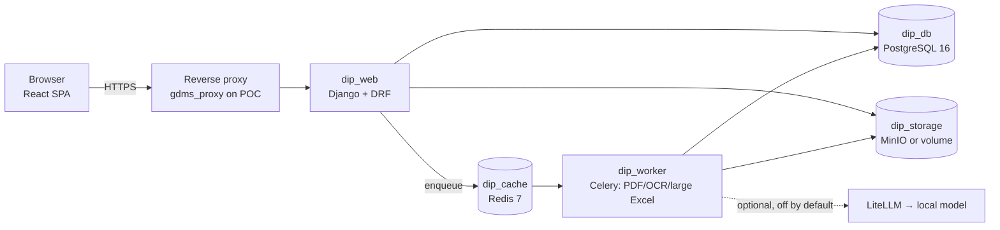

# Nia Document Import & Transformation Platform: Phase 0 Discovery Report

"DIP" is a working name used in this report (Document Import Platform). The product name and container prefix are open decision D-01.

## 1. What was inspected, and what could not be

| Source | Inspected? | Notes |
|---|---|---|
| Master project prompt (`duty_data.md`) | Yes, in full | Also present on the laptop at `Nia/TDH/tdh-dt/duty_data.md`. |
| Ukwazi Group project knowledge (33 docs) | Searched and read selectively | Tech-stack overview, TDH pending steps (18 Oct), OBR-001, TDC-001 A1, FRM/OBR handoff, Gemini duty reference. |
| Project memory | Yes | Architecture principles, infrastructure environments, company overview, TDH status, naming. |
| Laptop folder `~/Documents/Ukwazi Group` | Listed in full (681 entries); key files read | The laptop shell did not start, so files were listed and staged rather than searched in place. |
| CI/CD and security standards | Yes | `UKW-DEV-CICD-001 v1.0` and `UKW-SEC-SCAN-001 v1.0` (in `Technology/CI-CD-Policy.zip`). |
| `ukw-dev` (ukw-svr-dev-01) | **No** | Not reachable from this session. Facts below come from records dated 1–18 Oct 2026 and must be re-checked. |
| `ukw-poc` (ukw-svr-poc-01) | **No** | Same as above. |
| GitHub (`SlimSKM/nia-tdh` and others) | **No** | No GitHub access in this session. |
| Makhado duty-sheet PDF | **Not found** | Not in the laptop folder or the project. |
| `duty-import-template_dolight.xlsx` | **Not found** | Not in the laptop folder or the project. |

**Nothing in this report claims a server was inspected or code was run.**

## 2. Headline findings

1. **No repository exists yet for this platform.** There is no codebase, repo or folder for it, apart from the prompt file in `Nia/TDH/tdh-dt/`. This is a greenfield build.
2. **The two fixture files the prompt depends on are missing.** Without the Dolight template, the export schema can't be confirmed (prompt §7 says don't invent fields). Without the Makhado PDF, the PDF approach can't be judged. **This blocks Phase 1 data-model and export work, but not the rest of Phase 1.**
3. **DIP overlaps heavily with Transit Data Hub (TDH).** TDH already has requirements for:
   - duty and block import from `.xlsx` into a reviewable draft (FR-OBR-035)
   - an anonymous Duty model (FR-OBR-031)
   - tenant-configurable Export Profiles over code-defined datasets such as "duty list" (FR-TDC-014)
   - an immutable package exporter with manifests and hashes (FR-TDC-010 to 013)
   - maker-checker approval and append-only audit.

   The Fare Matrix Reconciliation app (inside TDH) already has the patterns DIP needs: layout auto-detection, fingerprinted reusable "Import Templates", human review before commit, and byte-faithful openpyxl template exports. **Where DIP sits relative to TDH is the most important decision (D-02).**
4. **The prompt's backend choice differs from the group default.** The prompt names FastAPI, SQLAlchemy and Alembic. The group default is Django, DRF and django-tenants. FastAPI is used today only for the Transit API Gateway ingestion service. Both choices can be defended, but this one needs an ADR (D-03). **Resolved 9 Nov 2026: Django + DRF**, because DIP is to be merged into TDH, which is Django.
5. **The prompt conflicts with TDH policy on personal data.** Prompt §5 and §15 require the original document to be kept and traceable. TDH OQ-OBR-18 recommends deleting raw duty sheets right after parsing, because they carry driver names and ID numbers. **This is compliance-critical (D-06).**
6. **Infrastructure timing risks:**
   - The CA-signed SSH certificate expires **26 Nov 2026**; the recorded plan is to renew it by ~19 Nov.
   - The Virtarix POC subscription review is due **~28 Nov 2026**.
   - No Virtarix DPA is in place yet. One is required before real personal information (such as driver identities in duty sheets) is processed.

## 3. Existing Ukwazi/Nia context that applies

### 3.1 Standards DIP must follow (from records)

| Area | Group standard | Effect on DIP |
|---|---|---|
| Principles | Open-source first; self-hostable; compliance by design; ADR discipline | All prompt choices fit. Record deviations as ADRs. |
| Data residency | POPIA §72: SA-hosted only (Virtarix JHB now, AWS af-south-1 or Azure SA later) | OCR and any AI extraction run in SA. No external AI by default. |
| Database | PostgreSQL 16. SQLite only for sandboxed testing, never deployed | The prompt allows SQLite for local dev. Recommend PostgreSQL in dev too; SQLite only for pure unit tests. |
| Audit | Append-only audit tables enforced in PostgreSQL (triggers, REVOKE UPDATE/DELETE from the app role); hash chaining where needed | Audit log, approvals and export history follow this. ORM choice doesn't matter here. |
| Tenancy | Schema-per-tenant (django-tenants) is the group pattern | Prompt §21 says don't build full multi-tenancy yet. Design now so schema isolation can be added without a rewrite (D-05). |
| Async | Celery + Redis 7 (Specta; added to TDH) | OCR and large PDFs justify a worker from Phase 4. |
| Object storage | MinIO (Specta) | Recommended for originals and generated files. Avoid the public 9000/9001 exposure found on Specta (finding F2). |
| File generation | openpyxl (template reuse), ReportLab 4.4.10 (not WeasyPrint), stdlib `csv` | Use directly for exports and reports. |
| E2E testing | Playwright | Use for upload → export E2E tests. |
| CI/CD | `UKW-DEV-CICD-001`: GitHub Actions 7-stage template, ≥70 % coverage, SemVer with `-dev`/`-rc.N`, rollback within 15 min, every migration has a tested down step | Every Django migration must be reversible and tested backwards (`migrate <app> <previous>`); data migrations need a `reverse_code`. Tag `vX.Y.Z-rc.N` for ukw-poc. |
| Security scanning | `UKW-SEC-SCAN-001`: Semgrep, Bandit, pip-audit, npm audit, OWASP Dependency-Check, Gitleaks, detect-secrets | The repo must contain `.gitleaks.toml`, `.secrets.baseline`, `semgrep.yml`, `dependency-check-suppression.xml` and `SECURITY.md` from day one. |
| AI | LiteLLM gateway → PydanticAI; Ollama (Track A/dev) / vLLM (Track B); Langfuse. ADR pending sign-off | Any AI-assisted extraction goes through LiteLLM to a local model. It's off by default and is a Track B (client data) concern. |
| Naming | Containers `<product>_<role>`; hostnames `[product]-dev` / `[product]-poc.glossdata.co.za` | Needs a product slug (D-01). |
| Containers | Docker + Compose v2 now; Podman evaluation pending; Compose → Helm 1:1 later | Keep Compose services Helm-friendly: one process per container, config through environment variables. |

### 3.2 Reusable assets

| Asset | Where | Reuse |
|---|---|---|
| Fare Matrix layout detection, fingerprinted Import Templates, review-then-commit flow, byte-faithful template export | TDH `apps/fares` (`services.py`, `exporters.py`, `matching.py`); local copy at `Nia/TDH/tdh/` | Port the algorithms, not the Django code. Header detection and template fingerprinting map directly onto DIP provider profiles. |
| ReportLab and openpyxl report exporters | TDH `apps/reporting/exporters.py` | Pattern for processing reports. |
| TDH OBR Duty and Block model; Export Profile design | OBR-001 v0.3, TDC-001 A1 | DIP's standard schema should be a **subset of the TDH canonical duty model**, so DIP output can load into TDH without remapping. |
| Gemini sample duty sheet (illustrative only, redacted) | Project reference doc | Synthetic test fixture. Not real data. |
| CI pipeline template | `UKW-DEV-CICD-001` §7 | Copy into `.github/workflows/ukwazi-pipeline.yml`. |
| `provision-virtarix-vps.sh` | `Nia/Pulse/poc/deploy/` | Reference only. Both servers are already provisioned. |

**Housekeeping noticed:** the local `Nia/TDH/tdh/` folder is an old single-commit copy of the Fare Matrix app, not the live TDH repo. Its `media/` holds real client `.xls` files. They are correctly git-ignored, but they're a POPIA/commercial-confidentiality item to keep in mind.

## 4. Environment constraints: `ukw-dev` and `ukw-poc`

From records dated 1–18 Oct 2026, not re-checked:

| | ukw-dev (ukw-svr-dev-01) | ukw-poc (ukw-svr-poc-01) |
|---|---|---|
| Spec / OS | Virtarix Cloud VPS M, 6 vCPU / 16 GB / 100 GB NVMe, Ubuntu 26.04.1 | Same |
| Access | `skmadm`, port 2121, CA-signed SSH certificate (expires 26 Nov) | Same |
| Docker | Engine + Compose plugin (4 Oct) | Present |
| Reverse proxy | **None recorded.** TDH dev publishes on 127.0.0.1:8000 only | Shared `gdms_proxy` (Nginx) on 80/443, with server blocks under `/opt/gdms/bridge/gdms_bridge/nginx/conf.d/` |
| Co-tenants | TDH dev (`/opt/nia/tdh/dev`) | Specta (7 containers), TDH (`tdh_web`, `tdh_db`), Moyo monitoring stack, Fare Matrix |
| Known issues | — | Specta Celery containers crash-loop (`django_otp`); Specta `/admin/` over HTTP and MinIO 9000–9001 public (F2) |

What this means for DIP:

- **Shared POC host.** DIP on ukw-poc competes with Specta, TDH and Moyo for 6 vCPU and 16 GB. Tesseract OCR is CPU-heavy, so the DIP worker needs hard `cpus`/`mem_limit` caps and a concurrency limit of 1–2.
- **Proxy changes touch other products.** Adding DIP to `gdms_proxy` means a new `conf.d` file and an `nginx -t` + reload on a proxy that also serves Specta and TDH. Each change needs explicit approval and a rollback step, following the OPS-14 runbook pattern.
- **Loopback binding is mandatory.** Docker bypasses UFW, so every DIP port except the proxy must bind to 127.0.0.1.
- **The dev server has no proxy.** For browser testing on ukw-dev, use an SSH tunnel (recommended; no new infrastructure) or add a dev proxy (D-08).
- **Before any connection**, re-run the §4 checklist from the prompt: `docker ps`, `docker network ls`, `docker volume ls`, `df -h`, `free -h`, `ss -tlnp`, and the proxy conf.d listing. Do this read-only on both servers.

## 5. How Cowork and Claude Code should divide the work

This follows the pattern already used for TDH: Cowork writes prompts and runbooks, Claude Code executes and reports, Cowork reviews.

| Cowork (Ubuntu desktop, this project) | Claude Code (VS Code, Remote-SSH on ukw-dev) |
|---|---|
| Discovery, requirements (URD), architecture spec, ADR drafts, ERD, wireframes, test strategy | Repo creation, branches, commits, PRs to GitHub |
| Phase prompts for Claude Code (`docs/prompts/DIP-Mx-phaseA-…txt`) with explicit scope and report-back format | Implementing exactly the prompt's scope; running tests, linters and scanners; reporting results |
| Reviewing Claude Code reports; deciding the next phase with you | Docker builds and the dev stack on ukw-dev |
| Server runbooks with `CHECK` steps (read-only discovery first) | Running read-only discovery commands on servers when you ask |
| Project memory, context exports, decisions log (master copies live in the claude.ai project) | Keeping `docs/` in the repo in step with the code; `CHANGELOG.md` |
| POPIA/GDPR review of designs | Never deploys to ukw-poc or restarts shared services without an approved runbook |

The project copy of each doc is the master until the repo exists. After that, `docs/` in Git is authoritative for implemented behaviour (prompt §19).

## 6. Recommended initial repository structure

New private repo, e.g. `SlimSKM/nia-dip` (name depends on D-01). Monorepo:

```
nia-dip/
├── README.md  CLAUDE.md  SECURITY.md  CHANGELOG.md
├── .gitignore  .env.example  .pre-commit-config.yaml
├── .gitleaks.toml  .secrets.baseline  semgrep.yml  dependency-check-suppression.xml
├── .github/workflows/ukwazi-pipeline.yml
├── backend/                        # Django project, laid out like nia-tdh
│   ├── manage.py  pyproject.toml   # pins match TDH (Django 5.2.x, django-tenants 3.14.x, DRF)
│   ├── config/                     # settings (env-based), urls, asgi/wsgi, celery
│   ├── apps/                       # Django apps, named so they can move into TDH unchanged
│   │   ├── accounts/               # users, roles (per-tenant, as TDH)
│   │   ├── imports/                # batches, source documents/units, raw + staged records, review
│   │   ├── profiles/               # operator import profiles + versioning
│   │   ├── exports/                # export templates, export records, history
│   │   ├── reporting/  audit/  retention/
│   │   └── api/                    # DRF routers/serializers under /api/v1, no business logic
│   ├── dip_core/                   # framework-independent Python: ingestion (excel/, pdf/, ocr/),
│   │                               # header detection, mapping, normalisation, validation, dedup,
│   │                               # template export. No Django imports; own unit tests.
│   └── tests/{unit,integration,fixtures/synthetic}/
├── frontend/                       # Vite + React + TypeScript
│   └── src/{app,api,components,features/{dashboard,upload,review,mapping,approval,export,reports},lib}
├── deploy/
│   ├── docker/{backend,frontend,worker}.Dockerfile
│   ├── nginx/                      # app-local config; proxy snippets for gdms_proxy
│   ├── compose/docker-compose.yml + .dev / .test / .poc / .prod overrides
│   └── scripts/{backup,restore,smoke}.sh
├── fixtures/README.md              # where real fixtures live (outside Git) and how to get them
└── docs/
    ├── discovery/  requirements/  architecture/architecture-decision-records/
    ├── database/  api/  user-guide/  developer-guide/  testing/
    ├── deployment/  security/  operations/  roadmap/  prompts/  reference/
```

Points to note:

- `.gitignore` excludes `.env*` (except `.env.example`), `*.db`, `uploads/`, `media/`, `storage/` and every real fixture.
- Real client documents (Makhado PDF, Dolight template) are kept **outside Git**, in a restricted folder on ukw-dev, unless you authorise otherwise (prompt §17). Synthetic look-alike fixtures go in Git.
- Business logic stays out of routers. Provider-specific behaviour lives only in profile configuration, never in `if provider == …` code.

## 7. Recommended architecture (for Phase 1 to formalise)



Data lineage is immutable at each stage, which meets the "never silently discard" requirement:

`Source Document (hash)` → `Source Unit (sheet/page/table)` → `Raw Record (original values + original field names + location)` → `Standard Record (mapped + normalised, profile version)` → `Validation Results / Discrepancies` → `Approval` → `Export Record` → `Export File (hash, manifest)`

Three separate status fields: processing status, review/approval status and export status (prompt §10).

## 8. Assumptions

| # | Assumption |
|---|---|
| A1 | The MVP is internal (Ukwazi/Gloss Data staff only). No operator users log in during the MVP. |
| A2 | One organisation in the MVP. The data model carries an owning organisation so tenancy can be added later. |
| A3 | Makhado duty sheets arrive as PDF (text-based, possibly scanned), and the Dolight template is the target of the first export. |
| A4 | "Dolight" is a downstream system or customer whose import format the template represents. Its owner and the field rules beyond the workbook are unknown. |
| A5 | The four standard fields (Duty No., Route, Trip Start, Trip End) are the MVP minimum and will be checked against the template. Others (day type, direction, block, depot) are added only if the template or source needs them. |
| A6 | GitHub (under `SlimSKM`) is the remote, matching TDH. GitHub Actions is the CI platform per UKW-DEV-CICD-001. |
| A7 | Moderate volumes: tens of documents per batch and up to a few thousand rows. To be confirmed (D-10). |

## 9. Risks

| # | Risk | L / I | Mitigation |
|---|---|---|---|
| R1 | DIP duplicates TDH import and export capability, so there are two code paths for duties | H / H | Decide D-02 first. Align the standard schema with the OBR Duty model. |
| R2 | Duty sheets contain driver names and ID numbers (POPIA special handling; ID numbers are unique identifiers) | H / H | D-06: identity-column detection and redaction at parse time, originals encrypted with short retention, access logged. DPA with Virtarix before real data. |
| R3 | Scanned or rotated PDFs and multi-page tables give poor extraction; the platform reports success it didn't achieve | M / H | Per-cell and per-row confidence, an "uncertain" state, a mandatory review gate, and a regression corpus. |
| R4 | Missing fixtures cause invented export fields | H / M | Block export-template design until the template is supplied. |
| R5 | OCR load on the shared POC host degrades Specta, TDH and Moyo | M / H | Worker CPU and memory limits, concurrency cap, off-peak batch option. |
| R6 | A `gdms_proxy` change breaks other products | L / H | Separate conf.d file, `nginx -t` before reload, scripted rollback, change window. |
| R7 | SSH certificate expires 26 Nov, locking out both servers | M / M | Renew by ~19 Nov. |
| R8 | POC subscription review on ~28 Nov changes the hosting plan mid-project | M / M | Keep deploys image-based and portable. Settle the hosting plan before Phase 8. |
| R9 | DIP and TDH drift apart before the merge (versions, naming, model meanings) | M / M | DIP pins the same Django and django-tenants versions as TDH, uses OBR-001 A1 §5 entity names, and follows the TDH M5 API contract and navigation rules. |
| R10 | Real client data committed to Git | L / H | Gitleaks plus a custom rule for SA ID-number patterns, fixtures kept outside Git, pre-commit hooks. |
| R11 | Scope size (23 doc deliverables, 8 phases) delays a working POC | M / M | Vertical slice first: Excel upload → map → validate → approve → Dolight export. |

## 10. Decisions needed from you

Ordered by how much they block.

| ID | Decision | Recommendation |
|---|---|---|
| **D-01** ✅ DECIDED 2026-11-09: working slug `dip` | Product name and runtime prefix | A Nia-style name (your call). Until then use the working slug `dip` (`dip_api`, `dip_db`, `dip-dev.glossdata.co.za`). |
| **D-02** ✅ DECIDED 2026-11-09: standalone Nia service | Relationship to TDH: standalone product, TDH module, or shared ingestion service that TDH also uses | **Standalone Nia service with its own repo, DB and containers.** Its canonical duty output matches the TDH OBR model, and it exports to TDH as one target. This keeps the prompt's generic multi-use-case aim without blocking on TDH's M2–M8 sequence. TDH's OBR importer can later call DIP instead of building its own. |
| **D-03** ✅ DECIDED 2026-11-09 (revised): Django + DRF | Backend framework | **Django + DRF on TDH's versions.** Changed from FastAPI the same day, because DIP is to be merged into TDH, front end included (OBR-001 A1 §13). The merge is then mostly moving apps; auth, admin, django-tenants and the group audit patterns come ready-made. This departs from the master prompt's stack (§3) and is recorded as ADR-DIP-002. Async processing uses Celery, not async views. |
| **D-04** | Supply the fixtures | Upload the Makhado duty-sheet PDF and `duty-import-template_dolight.xlsx` (and the Dolight import rules, if any), and confirm whether they hold real personal data. |
| **D-05** ✅ DECIDED 2026-11-10 | Tenancy model for the MVP | **django-tenants from day one, with one tenant**, the same as TDH (per-tenant users, public schema for platform staff only). This adds little work and avoids a schema migration at merge. |
| **D-06** ✅ DECIDED 2026-11-09: keep encrypted, short retention | Originals vs personal data (prompt §5 vs OQ-OBR-18) | Keep originals, **encrypted at rest**, in restricted storage with a short default retention (e.g. 30 days, configurable). Detect identity columns and redact them in raw records at parse time, and never store them in standard or export records. Log every access to originals. Raise this with the TDH OQ-OBR-18 owner so both products follow one policy. |
| **D-07** ✅ DECIDED 2026-11-10 | Async infrastructure | Add Celery + Redis in **Phase 4 (PDF/OCR)**, not at the start. Phases 2–3 process Excel synchronously, with size limits. |
| **D-08** ✅ DECIDED 2026-11-10 | Dev access on ukw-dev | SSH tunnel to loopback ports. No new proxy on dev. |
| **D-09** ✅ DECIDED 2026-11-10 (revised) | Object storage | **Encrypted local volume behind a storage interface** (ADR-DIP-006). No MinIO for the interim DIP; TDH decides MinIO or SeaweedFS in M3. |
| **D-10** ✅ DECIDED 2026-11-10: Medium | Expected volumes and file sizes | Up to 50 documents per batch; up to 10,000 rows or 100 PDF pages per document; daily batches. |
| **D-11** ✅ DECIDED 2026-11-10 | AI-assisted extraction | Out of the MVP. Assess in Phase 4 after the deterministic results on the Makhado PDF are known. If adopted: LiteLLM → local model only, off per provider profile by default. |
| **D-12** ✅ DECIDED 2026-11-10 | Roles | Administrator, Import Operator, Reviewer/Approver, Read-only. Add maker-checker: a user can't approve a batch they imported, matching the TDH governance pattern. |

## 11. Proposed Phase 1 specification plan

Document IDs follow the TDH convention. Each item ends with a review by you.

| Step | Deliverable | Content | Depends on |
|---|---|---|---|
| 1.1 | ADR-DIP-001 to 006 | Placement (D-02), framework (D-03), tenancy (D-05), personal data and retention (D-06), async (D-07), storage (D-09) | Your answers to section 10 |
| 1.2 | **DIP-URD-001** Requirements | Business, functional and non-functional requirements in the TDH URD format (ID, requirement, MoSCoW, acceptance criteria), user stories, open questions, POPIA section | 1.1 |
| 1.3 | Fixture analysis note | Structure of the Makhado PDF and Dolight template: sheets, columns, types, validation, conventions | **D-04 files** |
| 1.4 | **DIP-PDS-001** Architecture spec | Components, Mermaid architecture and data-flow diagrams, processing pipeline, profile and template config schema (JSON Schema 2020-12), security design, deployment topology | 1.2 |
| 1.5 | Data model + ERD | Logical → physical model, statuses, lineage keys, constraints and indexes, audit triggers, migration strategy | 1.3, 1.4 |
| 1.6 | API design | OpenAPI 3.1 draft, versioned `/api/v1`, error model (RFC 9457) | 1.5 |
| 1.7 | UI wireframes | Dashboard, upload, review, mapping, approval, export, reports | 1.2 |
| 1.8 | Test strategy | Levels, tools (pytest, Vitest, Playwright), fixture policy, coverage ≥70 %, regression corpus, performance and security tests | 1.4 |
| 1.9 | Deployment design | Compose layout per environment, resource limits, proxy integration runbook for ukw-poc, backup and restore | 1.4, server re-check |
| 1.10 | Phase 2 prompt for Claude Code | Repo bootstrap scope and report format | 1.1–1.9 approved |

Steps 1.1, 1.2, 1.4 and 1.7 can start as soon as section 10 is answered. Steps 1.3 and 1.5 wait for the fixtures.

**Approved 10 Nov 2026; Phase 1 started.** DIP retires after TDH M10b (decided 10 Nov). Steps 1.1 (ADR-DIP-001 to 006) and 1.2 (DIP-URD-001 v0.1) delivered.
